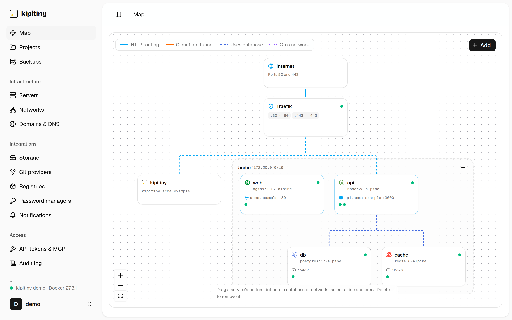
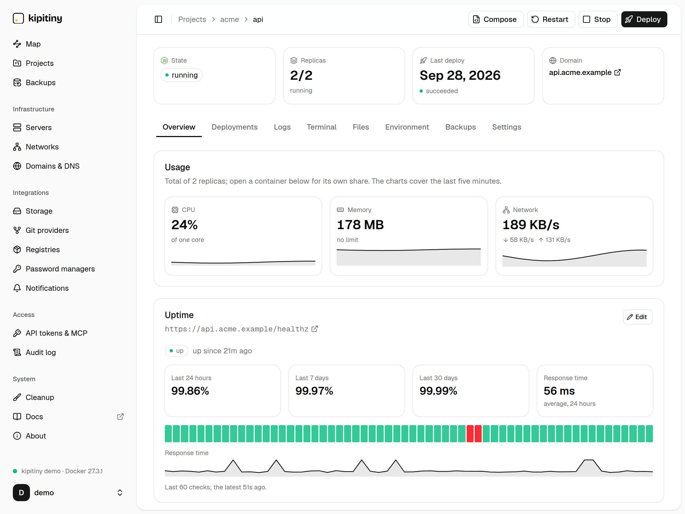
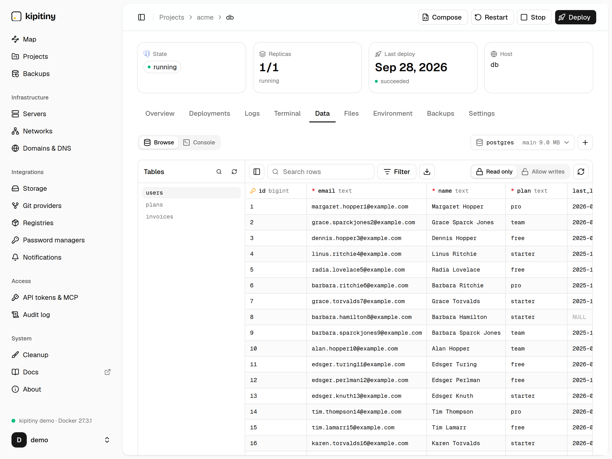
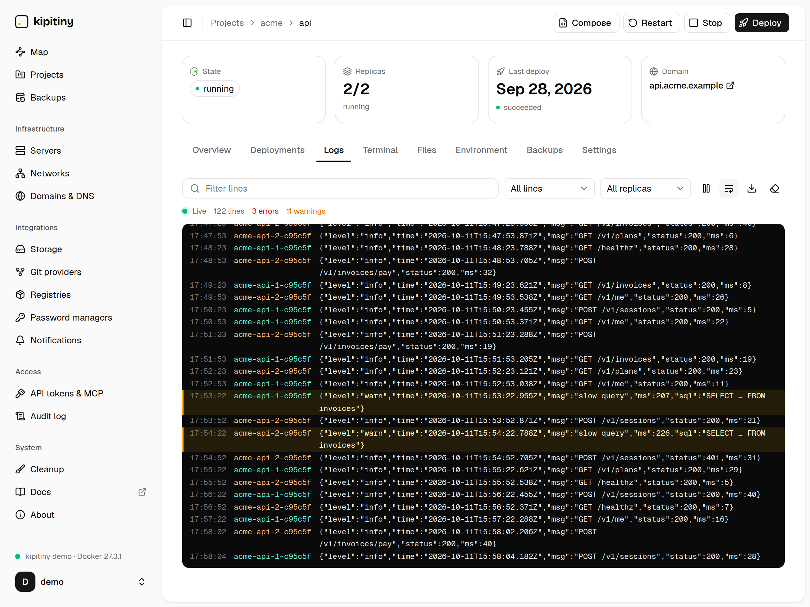
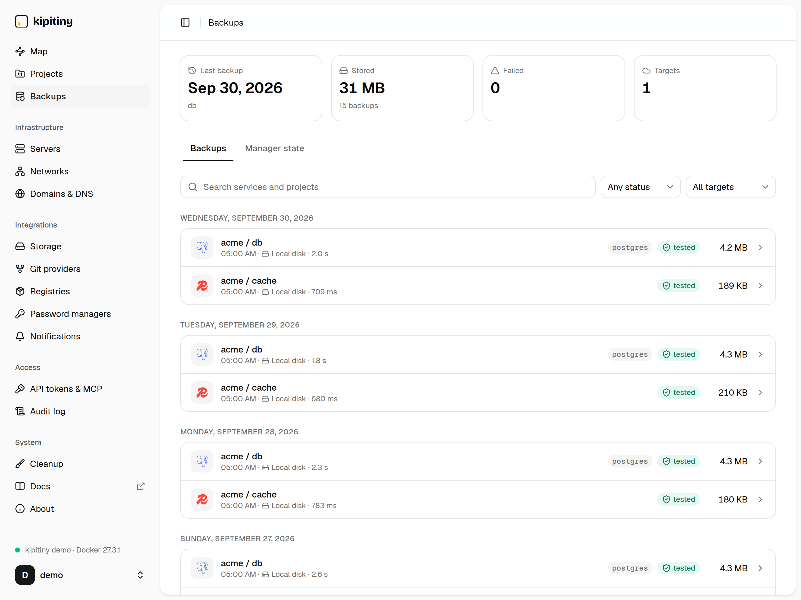
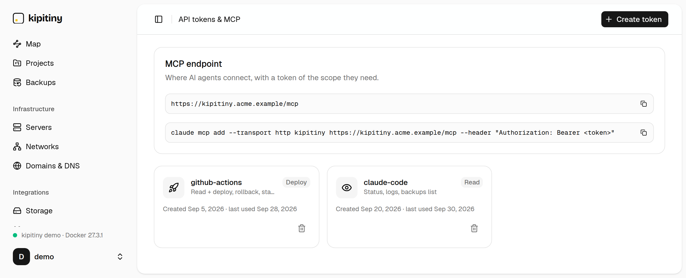

<h1 align="center">kipitiny</h1>

<p align="center">
  <b>Lightweight self-hosted PaaS.</b><br>
  Deploy Docker apps and databases with restore-tested backups, and let AI agents run them over MCP,<br>
  in about 15&nbsp;MB of RAM.
</p>

<p align="center">
  <a href="https://kipitiny.mathieuhoyer.fr/demo">Live demo</a> ·
  <a href="https://kipitiny.mathieuhoyer.fr/docs">Documentation</a> ·
  <a href="#run">Install</a> ·
  <a href="docs/design.md">Design</a>
</p>

<picture>
  <source media="(prefers-color-scheme: dark)" srcset="docs/screenshots/map-dark.png">
  
</picture>

## Features

- **Apps** from any image, public or private registry: HTTPS on your domain through Traefik, 1–10 replicas,
  health-gated deploys and rollback to an earlier image. Docker Compose import, export and git sync.
- **Databases**: PostgreSQL, MySQL, MariaDB, MongoDB and Redis, created in one step with generated credentials.
  Browse tables and keys, or run queries, from the UI.
- **Backups that restore**: every database backup is loaded into a throwaway container and read back before
  it counts. Local disk or any S3-compatible bucket, optional encryption, cron schedules with retention.
- **MCP server** built in: Claude Code, Cursor or any MCP client can check on apps, read logs, deploy, back up
  and query a database, with scoped tokens and every call in the audit log.
- **Small**: one static Go binary with the UI embedded and SQLite for state. About 15&nbsp;MB of memory and
  no CPU at rest; remote Docker hosts over SSH.

## Screenshots

<table>
  <tr>
    <td width="50%"><picture>
  <source media="(prefers-color-scheme: dark)" srcset="docs/screenshots/service-dark.png">
  
</picture></td>
    <td width="50%"><picture>
  <source media="(prefers-color-scheme: dark)" srcset="docs/screenshots/data-dark.png">
  
</picture></td>
  </tr>
  <tr>
    <td align="center"><sub>Every service: live usage, uptime checks, deploys, logs, terminal and files</sub></td>
    <td align="center"><sub>Browse and query PostgreSQL, MySQL, MariaDB, MongoDB and Redis</sub></td>
  </tr>
  <tr>
    <td width="50%"><picture>
  <source media="(prefers-color-scheme: dark)" srcset="docs/screenshots/logs-dark.png">
  
</picture></td>
    <td width="50%"><picture>
  <source media="(prefers-color-scheme: dark)" srcset="docs/screenshots/backups-dark.png">
  
</picture></td>
  </tr>
  <tr>
    <td align="center"><sub>Live logs across replicas, filtered by level</sub></td>
    <td align="center"><sub>Backups, each one restore-tested</sub></td>
  </tr>
</table>

<picture>
  <source media="(prefers-color-scheme: dark)" srcset="docs/screenshots/mcp-dark.png">
  
</picture>

Try it without installing anything: the [demo](https://kipitiny.mathieuhoyer.fr/demo) is the real interface,
running in your browser.

## Run

Only this repo's `docker-compose.yml` is needed on the server:

```sh
curl -fsSLO https://raw.githubusercontent.com/MatHoyer/kipitiny/main/docker-compose.yml
docker compose up -d   # http://localhost:3000
docker compose logs manager | grep setup_token
```

The UI asks for that one-time setup token to create the admin account. To set
up a fresh server (firewall, SSH hardening, Docker, kipitiny), use the Ansible
playbook in [`deploy/ansible`](deploy/ansible/README.md). Everything else is in
the [documentation](https://kipitiny.mathieuhoyer.fr/docs) (sources in [`site/docs`](site/docs)).

To let an agent drive it, create a token under **API tokens & MCP** and add the endpoint:

```sh
claude mcp add --transport http kipitiny https://your-server/mcp --header "Authorization: Bearer <token>"
```

## Develop

Screenshots in `docs/screenshots` come from the demo build (`cd web && pnpm dev:demo`).

Requires Go 1.26+, Node 24+, pnpm 10.

```sh
make dev-api   # Go API on :8080 (data in ./data)
make dev-ui    # Vite on :5173, proxies /api to :8080
make test      # go test ./...
make lint      # go vet + tsc
make build     # UI + static binary in bin/
make docker    # images `kipitiny` and `ghcr.io/mathoyer/kipitiny:dev`
make dev-site  # the website (landing page and docs) on :5173
KIPITINY_VERSION=dev docker compose up -d   # run that build
```

Docs are `site/docs/<slug>.md`: a new file is a new page. `go test
./internal/compose/` checks that `site/docs/compose.md` documents every key the
parser reads.

## Releasing

Push a tag `x.y.z` (no `v`): GitHub Actions publishes
`ghcr.io/mathoyer/kipitiny:x.y.z` and `:latest` for amd64 and arm64, and a
GitHub release; the website image `ghcr.io/mathoyer/kipitiny-homepage` is rebuilt from the same tag, so its docs describe the latest release (run the *site* workflow by hand for a site-only fix). After the first release, make the package public (GitHub →
Packages → kipitiny → Package settings), or managers can neither see nor pull
updates.

## Layout

```
cmd/kipitiny/          entrypoint
internal/config/       env config
internal/core/         service layer (REST + future MCP call this)
internal/api/          JSON HTTP handlers
internal/docker/       Docker client wrapper, label/network conventions
internal/store/        Store interface + models
internal/store/sqlite/ SQLite impl (bun + goose migrations)
web/                   React SPA (Vite), embedded via go:embed
site/                  website: landing page and docs (site/docs/*.md), own image
```
